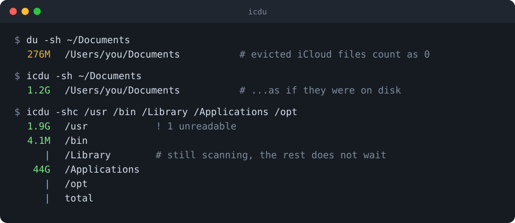

# icdu

[](https://www.npmjs.com/package/icdu)
[](https://github.com/reachdevel/icdu/actions/workflows/ci.yml)
[](LICENSE)


`du` for macOS that knows about iCloud.



When iCloud Drive's *Optimize Mac Storage* evicts a file, the file still shows up in Finder and in `ls`
with its full size, but it takes no space on disk, so `du` reports `0` for it. `icdu` counts those files
as if they were still stored locally: it prints what `du` would print on a machine where nothing had been evicted.

```console
$ du -sh ~/Documents
276M    /Users/you/Documents
$ icdu -sh ~/Documents
1.2G    /Users/you/Documents
```

Everything else is meant to be exactly `du`: same options, same output format, same order, same exit codes.
If you want plain `du` numbers, `icdu --local` gives them to you.

## Install

```sh
npm install -g icdu
```

macOS only (it refuses to install elsewhere). Needs Node.js 18 or newer.

## Usage

Use it like `du`:

```sh
icdu -shc ~/Documents ~/Desktop ~/Library/Mobile\ Documents
icdu -d1 -h ~/Library
icdu -Sh -d1 ~/Library          # biggest folders first
icdu -shcS ~/Documents ~/Desktop # one line per folder, biggest first
```

Like `du`, `-h` and `--si` print the decimal separator of your locale (`4,1M` with a Turkish or German `LC_NUMERIC`).
Options follow macOS `du(1)`: `-A -a -B -c -d -g -H -h -I -k -L -l -m -n -P -r -s -t -x --si` and the
`BLOCKSIZE` environment variable. `icdu --help` lists them.

Extras that are not in `du`:

| | |
|---|---|
| `-S` | Sort the printed lines by size, largest first (like `ls -S`); add `-r` for smallest first (`-Sr`). Equal sizes keep `du`'s order and `-c`'s total stays last. |
| `--local` | Count only what is stored on this Mac, exactly like `du`. Also `ICDU_LOCAL=1`. |
| `--plain` | No live table, no progress display. Also `ICDU_PLAIN=1`, or when `CI` is set. |
| `--help`, `--version` | |

### On a terminal

`icdu -s a b c d` prints one line per operand. In a terminal each line shows a spinner until its
directory has been scanned and then fills in, so quick directories appear without waiting for slow ones.
When everything is done, the screen holds exactly what `du` would have printed. Two dim notes may appear:

```
  0B  /etc    -> private/etc      (a symlink; du does not follow it either, hence 0)
 1.9G /usr    ! 1 unreadable      (permission errors: the number is incomplete)
```

Entries that cannot be read (permission errors, protected macOS folders) are counted instead of listed one by one:
the table shows `! N unreadable`, and listings end with a single `icdu: N entries could not be read` line on stderr.
To see which paths failed, run again with `--plain`, or redirect stderr (`icdu ... 2>errors.txt` keeps the full list).
Errors for an operand itself (for example a path that does not exist) are always printed.

For listings (`-a`, `-d1`, no `-s`) a progress counter is shown on stderr while scanning. Piped or redirected
output is plain `du`-style text; nothing decorative is written. `--plain` turns the decorations off on a terminal too.

## Troubleshooting

- **`Operation not permitted`** on folders like `/Library/Application Support/com.apple.TCC` or `/Library/Trial` is macOS protecting
  them. Grant your terminal app *Full Disk Access* (System Settings -> Privacy & Security) to include them, or ignore it:
  the number is then a lower bound, which is what `du` gives you too.
- **`Permission denied`** is an ordinary permission problem; run with `sudo` if you need those directories.
- **A directory shows `0B`** and the line ends with `-> somewhere`: it is a symlink, which `du` does not follow without `-H` or `-L`.

## How it works

- Every file and directory is examined with `lstat`. Files and directories are never opened or read, so nothing is
  downloaded from iCloud.
- A regular file with a size but no allocated blocks is either *evicted* (marked `UF_DATALESS`) or a fully sparse
  file. The flag is read with `stat(1)` in a few bulk calls. Evicted files are charged `ceil(size / 4096)` APFS
  blocks, which is what they occupy once downloaded. Sparse files stay at 0, like in `du`.
- Hard links are counted the way `du` counts them, including its habit of forgetting a file once all its links were seen.
- The tree is scanned with 16 concurrent filesystem calls and printed in `du`'s order afterwards.

`icdu` is checked against `/usr/bin/du` by differential tests: for ordinary trees, and with `--local` for iCloud
trees, the output must be byte-identical.

## Performance

Faster than `du` on big trees (about 6 s against 7-9 s for a 44 GB `/Applications` with 566k entries) and slower on
small, fast ones (about 0.4 s against 0.2 s for `/usr`), because of Node's start-up time and a higher per-entry cost.
`du` uses a bulk system call that Node cannot reach. Cold caches favor `icdu`: the parallel scan hides disk latency.

## Limitations

- **macOS only**, tested on macOS 26 (Apple silicon, APFS) with Node 18, 20, 22 and 25 only. Other macOS versions may
  differ in `du -h`, `-t`, `-I` and `stat(1)` details; run `npm test` to compare with your own `du`.
- **Memory:** the whole tree is held in memory, about 0.8 KB per entry (`-s`) or 1.5 KB (`-a`). Scanning `/` on a
  full disk can exceed Node's default heap.
- **Time Machine:** directories hard-linked by Time Machine backups are not de-duplicated like `du` does.
- **Old iCloud stubs:** the `.name.icloud` placeholders of pre-Sonoma macOS are not recognized.
- **File names that are not valid UTF-8** (possible on exFAT/NTFS/SMB volumes, impossible on APFS) are not handled.
- If a file's flags cannot be read during the scan (it vanished, or its name contains a line break), a file without
  blocks is assumed to be evicted, which can over-count a fully sparse file.
- Some `du` behaviors were reproduced from observation, not source: a negative `-t` hides every directory, `-I`
  matches the base name only, and a symlink cycle under `-L` ends the run. Warnings are printed while scanning, so
  their order can differ from `du`.
- The live table is made for ordinary terminals; very wide characters in names or resizing the window while it runs
  can garble it. Use `--plain`.

## Development

```sh
npm install
npm test        # builds, then runs the tests; needs macOS
```

Some tests use evicted files from your own `~/Documents` or `~/Desktop` and are skipped when there are none.
The tests never modify or delete anything outside temporary directories.

## Contributing

Bug reports, `du` mismatches and small pull requests are welcome, see [CONTRIBUTING.md](CONTRIBUTING.md).
Changes are listed in [CHANGELOG.md](CHANGELOG.md); security issues go through [SECURITY.md](SECURITY.md).

## License

MIT, see [LICENSE](LICENSE).
